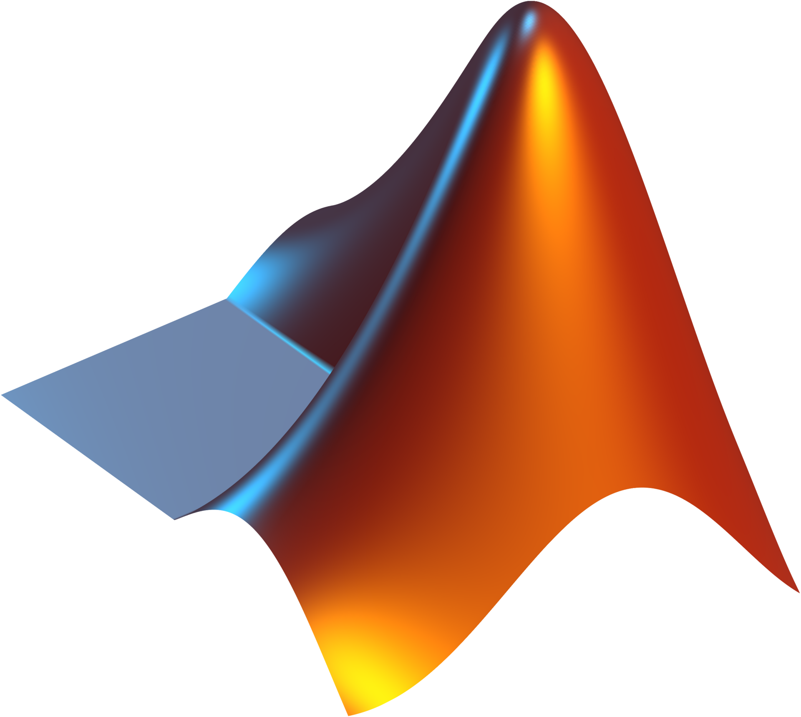

# Curso de Matlab-Simulink con enfoque a problemas de control

El propósito del repositorio es dejar constancia de los trabajos realizados durante el cursado, tanto en código como el desarrollo de la documentación. 

**Tabla de Contenidos**

- [Semana 1: Introducción al curso](#semana-1-introducción-al-curso)

- [Semana 2: Parámetros en MATLAB, Simulink y funciones básicas de control](#semana-2-parámetros-en-matlab-simulink-y-funciones-básicas-de-control)

- [Semana 3: Características de sistemas lineales y errores y ayuda en MATLAB y Simulink](#semana-3-características-de-sistemas-lineales-y-errores-y-ayuda-en-matlab-y-simulink)

- [Semana 4: Matrices en MATLAB y respuesta transitoria](#semana-4-matrices-en-matlab-y-respuesta-transitoria)

- [Semana 5: Programar en MATLAB y errores en régimen permanente](#semana-5-programar-en-matlab-y-errores-en-régimen-permanente)

- [Semana 6: Compensadores proporcionales y funciones en MATLAB](#semana-6-compensadores-proporcionales-y-funciones-en-matlab)

- [Semana 7: Graficar resultados en MATLAB y tipos de datos](#semana-7-graficar-resultados-en-matlab-y-tipos-de-datos)
- [Semana 8: Personalizar MATLAB y sistemas lineales invariantes en el tiempo](#semana-8-personalizar-matlab-y-sistemas-lineales-invariantes-en-el-tiempo)

- [Semana 9: Adquisición y procesamiento de datos. Modelos avanzados en Simulink](#semana-9-adquisición-y-procesamiento-de-datos-modelos-avanzados-en-simulink)

- [Semana 10: Introducción al aprendizaje automático y compensadores lineales](#semana-10-introducción-al-aprendizaje-automático-y-compensadores-lineales)

- [Semana 11: Integración en MATLAB e identificación de sistemas lineales](#semana-11-integración-en-matlab-e-identificación-de-sistemas-lineales)

- [Semana 12: Interfaces gráficas y especialidades en MATLAB](#semana-12-interfaces-gráficas-y-especialidades-en-matlab)

